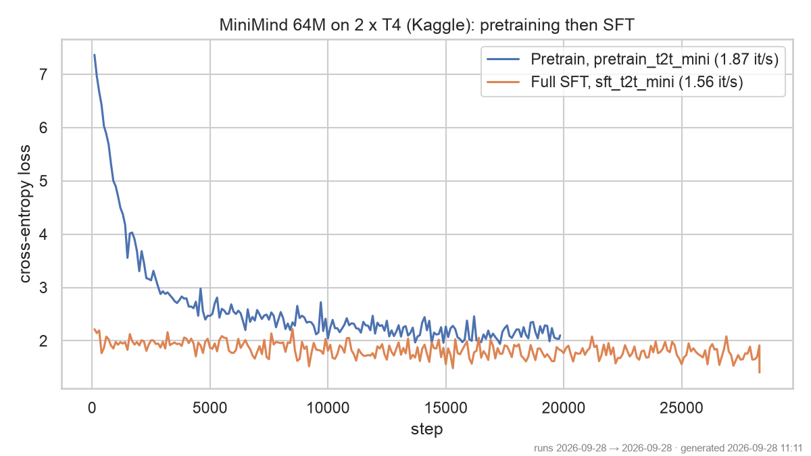

# minimind-lab

**Can a 64M-parameter language model be trained from scratch with a 16 GB laptop and a free GPU, then
served locally?** Yes: 8 hours on Kaggle's free 2 × T4, final SFT loss **1.405**, served by Ollama at
**~540 tokens/s** on an Apple M1 Pro. This lab wraps [MiniMind](https://github.com/jingyaogong/minimind)
(Apache-2.0, pinned as a submodule at `7a9137d`) **without modifying it**, and measures every step.



## Method

| Step | Where | How |
|---|---|---|
| Smoke test | M1 Pro, CPU and MPS | `scripts/cpu_smoke.sh`: 300 pretraining steps on the first 2,400 samples, seed 42 |
| Pretraining | Kaggle, 2 × Tesla T4 | `notebooks/kaggle_train.ipynb`: `torchrun`, 1 epoch of `pretrain_t2t_mini` (1.24 GB), float16 + GradScaler, upstream defaults (batch 32 × 340 tokens per GPU, accumulation 8) |
| Full SFT | same session | 1 epoch of `sft_t2t_mini` (1.74 GB), from the pretrained weights (batch 16 × 768 tokens per GPU) |
| Export | M1 Pro | `scripts/export_ollama.py`: upstream `convert_torch2transformers` → Qwen3 safetensors (fp16) → `ollama create` |
| Samples | M1 Pro | `scripts/sample_ollama.py`: 5 fixed prompts, seed 42 → `results/samples.md` |

Model: MiniMind-3 dense, **63.91M parameters** (hidden 768, 8 layers, Qwen3-compatible layout).

## Results

### Training on Kaggle (2026-09-28, `results/kaggle-env.txt`: torch 2.10.0 + CUDA 12.8, 2 × Tesla T4)

| Stage | Steps | Samples seen | Loss (first → last log) | Throughput | Time |
|---|---|---|---|---|---|
| Pretraining | 19,848 | 1.27 M | **7.363 → 2.101** | 1.87 it/s | 2.94 h |
| Full SFT | 28,304 | 0.91 M | **2.216 → 1.405** | 1.56 it/s | 5.04 h |

Total 7.98 h of training (8.05 h for the whole notebook, downloads included), inside Kaggle's 12 h
session limit. Upstream reports 2.31 h for the same two epochs on one RTX 3090: the two T4s are about
3.5 × slower.

### Throughput across hardware

Upstream pads every sequence to `max_seq_len`, so the comparable unit is tokens processed per second:
`it/s × batch × max_seq_len × GPUs`.

| Hardware | Precision | Batch × seq × GPUs | it/s | Tokens/s | vs CPU |
|---|---|---|---|---|---|
| M1 Pro CPU (8 cores) | fp32 | 8 × 128 × 1 | 1.06 | ≈ 1,085 | 1 × |
| M1 Pro GPU (MPS) | fp32 | 8 × 128 × 1 | 1.89 | ≈ 1,935 | 1.8 × |
| M1 Pro GPU (MPS) | fp16 autocast | 8 × 128 × 1 | 1.72 | ≈ 1,761 | 1.6 × |
| **2 × T4**, pretraining | fp16 | 32 × 340 × 2 | 1.87 | **≈ 40,700** | **37 ×** |
| 2 × T4, SFT | fp16 | 16 × 768 × 2 | 1.56 | ≈ 38,300 | 35 × |

The Mac rows come from the 300-step smoke test (same seed, same data); their three loss curves overlap,
so the device changes the speed, not the numbers ([figure](results/smoke_loss.png)). Upstream only
knows CUDA: any other device gets `nullcontext()` instead of autocast, so `--device mps` works as-is in
fp32. `scripts/mps_patch.py` swaps the autocast and GradScaler lines in memory (the submodule is
untouched) to test float16: at batch 8 × 128 the casts cost more than they save.

### The model, served by Ollama (`results/samples.md`)

128 MB in fp16, **≈ 540 tokens/s** on the M1 Pro. Excerpts (seed 42, temperature 0.7):

> **为什么天空是蓝色的？** — 「……因为大气层中的气体会散射阳光，使得天空看起来蓝色……」 (on topic, Rayleigh
> scattering in plain words, but repetitive)
>
> **Hello! What can you do?** — "Hello! What's the weather in Beijing?"

It answers in fluent, on-topic Chinese, with a `<think>` block learnt from the SFT data, and repeats
itself on longer answers. English is weak and French is nonsense: the training data is mostly Chinese.

## Reproduce

```bash
git clone --recurse-submodules <this repo> && cd minimind-lab && uv sync

# 1. Smoke test on the Mac (~5 min on CPU, ~3 min on MPS)
mkdir -p data && curl -L -r 0-33554431 -o data/head.part \
  https://huggingface.co/datasets/jingyaogong/minimind_dataset/resolve/main/pretrain_t2t_mini.jsonl
python3 -c "d=open('data/head.part','rb').read(); open('data/pretrain_t2t_mini.head32mb.jsonl','wb').write(d[:d.rfind(b'\n')+1])"
zsh scripts/cpu_smoke.sh                        # STEPS, BATCH, SEQ, DEVICE (cpu|mps), ENTRY overridable
DEVICE=mps ENTRY=$PWD/scripts/mps_patch.py LOG=$PWD/results/mps-fp16-smoke.log \
  zsh scripts/cpu_smoke.sh --dtype float16      # MPS float16

# 2. Kaggle: import notebooks/kaggle_train.ipynb, Accelerator "GPU T4 x2", Internet on,
#    Save & Run All (Commit); download minimind-out/ into results/checkpoints/

# 3. Export, sample, plot
uv run python scripts/export_ollama.py results/checkpoints/minimind-out/full_sft_768.pth minimind-jt
uv run python scripts/sample_ollama.py minimind-jt
uv run python scripts/plot_losses.py results/kaggle_loss.png \
  "Pretrain=results/kaggle-pretrain.log" "Full SFT=results/kaggle-full_sft.log" --title "..."
```

Upstream has no max-steps flag: the smoke test trains one epoch over `STEPS × BATCH` samples with
gradient accumulation 1. Upstream also writes a resume checkpoint to `upstream/checkpoints/` (ignored
locally through the submodule's `info/exclude`). On Kaggle, the datasets are fetched with
`huggingface_hub`: `curl` failed the TLS handshake with Hugging Face's CDN (exit 35).

## Limitations

- One epoch per stage and one run: no variance across seeds, no held-out evaluation beyond the training
  loss and five prompts.
- The loss is logged every 100 steps on a single batch, hence the noise on the curves.
- Throughput rows use different batch sizes and sequence lengths; tokens/s makes them comparable to first
  order only (attention cost grows with sequence length).

## Data and licences

See `results/DATASETS.md`. Code: Apache-2.0. Dataset card: Apache-2.0 **and CC-BY-NC-2.0**, so the model
trained here is for non-commercial use only. Weights are not versioned (`results/checkpoints/`).
