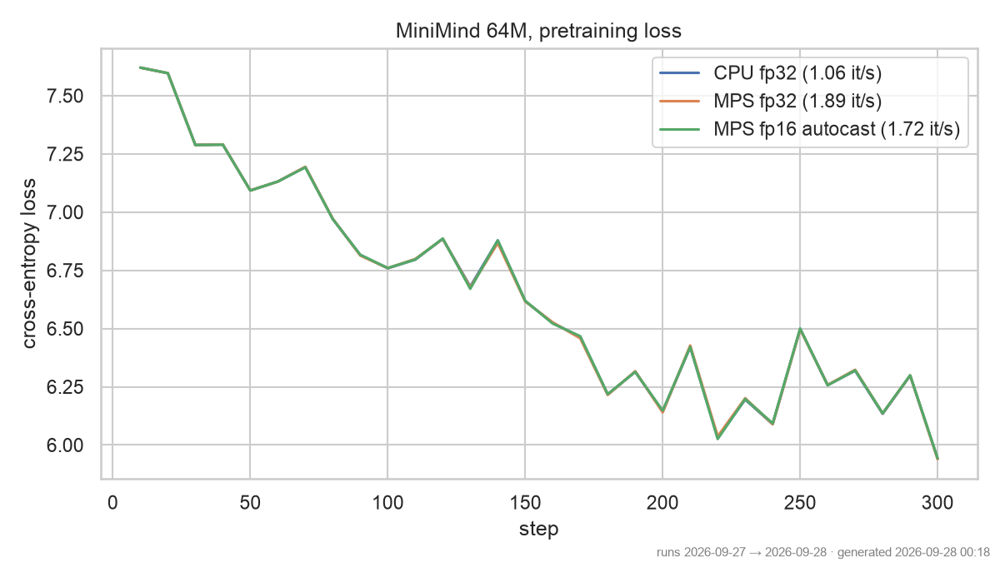

# minimind-lab

**Can a 64M-parameter language model be trained from scratch on a 16 GB laptop and a free GPU?** This lab
wraps [MiniMind](https://github.com/jingyaogong/minimind) (Apache-2.0, pinned as a submodule at `7a9137d`)
without modifying it: a CPU smoke test on an Apple M1 Pro, the real run on a free Kaggle T4, then export to
Ollama.

> Status (2026-09-27): CPU smoke test done. Kaggle training, Ollama export and loss curves: to come (SP7 T7.3).

## Results so far

CPU smoke test, 2026-09-27, Apple M1 Pro (8 cores), torch 2.14.0, `scripts/cpu_smoke.sh`:

| Model | Data | Steps | Batch × seq | Loss (step 10 → 300) | Throughput | Wall time | Peak RSS |
|---|---|---|---|---|---|---|---|
| MiniMind dense, 63.91M params (hidden 768, 8 layers) | first 2,400 samples of `pretrain_t2t_mini.jsonl` | 300 | 8 × 128 | **7.620 → 5.941** | **1.06 it/s** (≈ 1,085 tokens/s) | 307 s | 2.0 GB |

Log: `results/cpu-smoke.log` (each line prefixed with a Unix timestamp). Summary: `python scripts/parse_log.py results/cpu-smoke.log`.

### CPU vs Apple GPU (MPS), same 300 steps, same seed, 2026-09-28

| Device | Precision | Throughput | Loss 10 → 300 | Wall time | Peak RSS | Log |
|---|---|---|---|---|---|---|
| CPU (8 cores) | fp32 | 1.06 it/s | 7.620 → 5.941 | 307 s | 2.0 GB | `results/cpu-smoke.log` |
| **MPS** (M1 Pro GPU) | fp32 | **1.89 it/s (× 1.78)** | 7.620 → 5.939 | 171 s | 0.93 GB | `results/mps-smoke.log` |
| MPS | fp16 autocast + GradScaler | 1.72 it/s | 7.620 → 5.943 | 181 s | 0.94 GB | `results/mps-fp16-smoke.log` |



The three curves overlap (same seed, same 2,400 samples): the device changes the speed, not the numbers.

Upstream only knows CUDA: any other device gets `nullcontext()` instead of autocast, so `--device mps`
works as-is in fp32. `scripts/mps_patch.py` swaps the autocast and GradScaler lines in memory (the
submodule is untouched) to test float16: at this size (batch 8 × 128 tokens) the casts cost more than
they save, and fp32 stays the fastest option on this machine.

```bash
DEVICE=mps zsh scripts/cpu_smoke.sh                                                        # fp32
DEVICE=mps ENTRY=$PWD/scripts/mps_patch.py LOG=$PWD/results/mps-fp16-smoke.log \
  zsh scripts/cpu_smoke.sh --dtype float16                                                  # fp16
```

## Reproduce

```bash
git clone --recurse-submodules <this repo> && cd minimind-lab
uv sync
mkdir -p data && curl -L -r 0-33554431 -o data/head.part \
  https://huggingface.co/datasets/jingyaogong/minimind_dataset/resolve/main/pretrain_t2t_mini.jsonl
python3 -c "d=open('data/head.part','rb').read(); open('data/pretrain_t2t_mini.head32mb.jsonl','wb').write(d[:d.rfind(b'\n')+1])"
zsh scripts/cpu_smoke.sh          # STEPS, BATCH, SEQ, DEVICE overridable by env
```

Upstream has no max-steps flag: the script trains one epoch over `STEPS × BATCH` samples with gradient
accumulation 1. It writes the weights to `out/`; upstream also writes a resume checkpoint to
`upstream/checkpoints/` (ignored locally through the submodule's `info/exclude`).

## Data and licences

See `results/DATASETS.md`. Code: Apache-2.0. Dataset card: Apache-2.0 **and CC-BY-NC-2.0**, so any model
trained here is for non-commercial use only.
